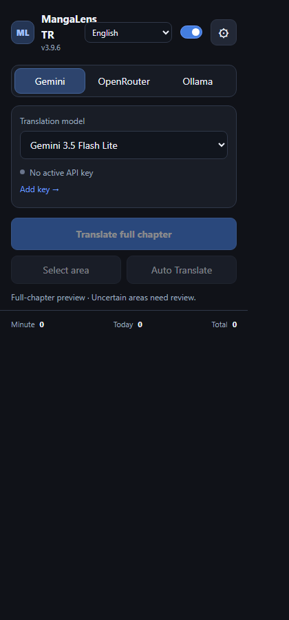
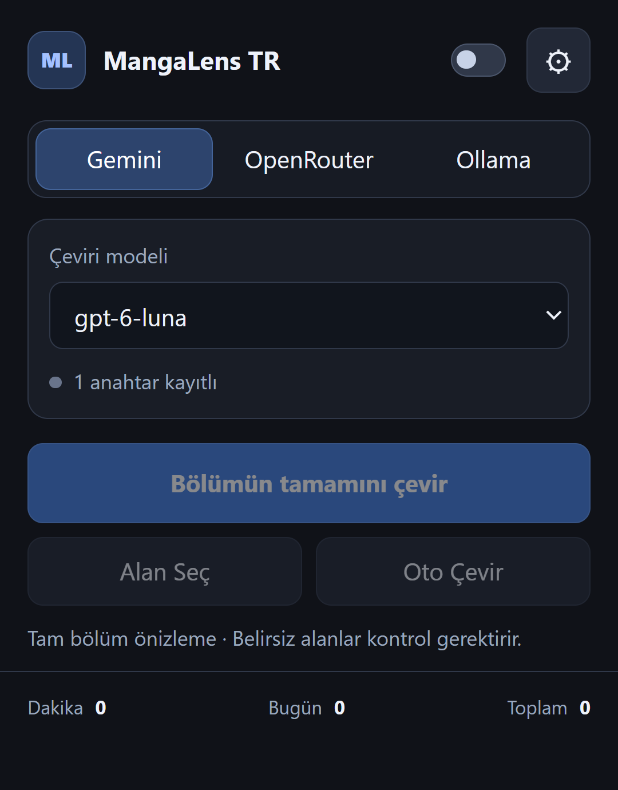
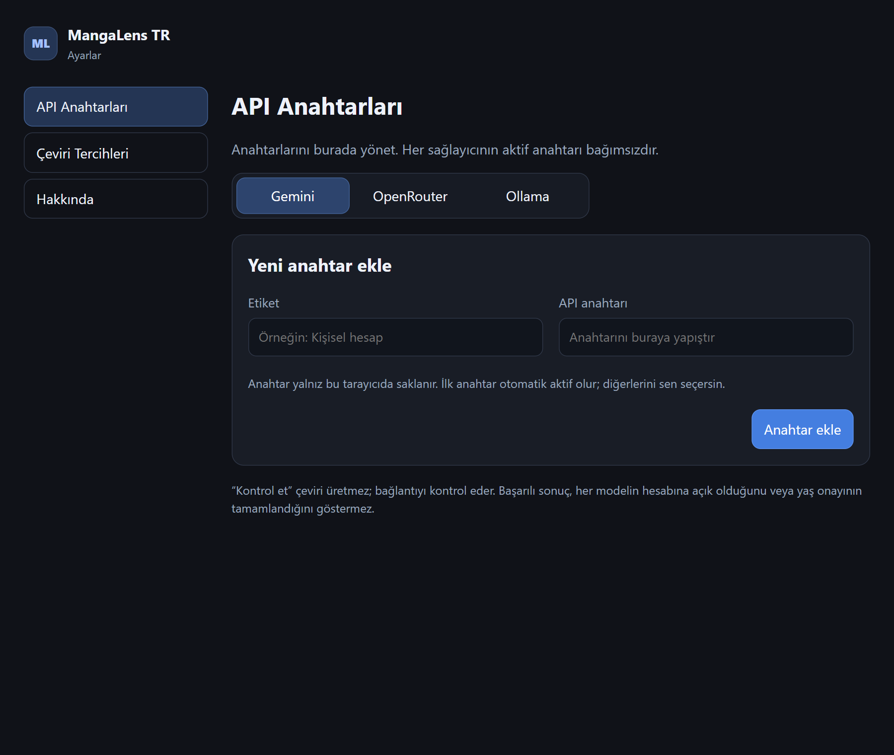
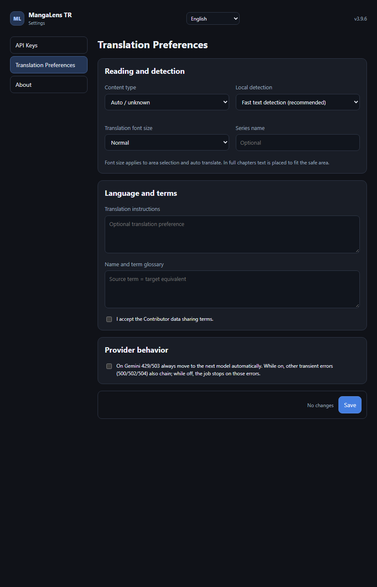
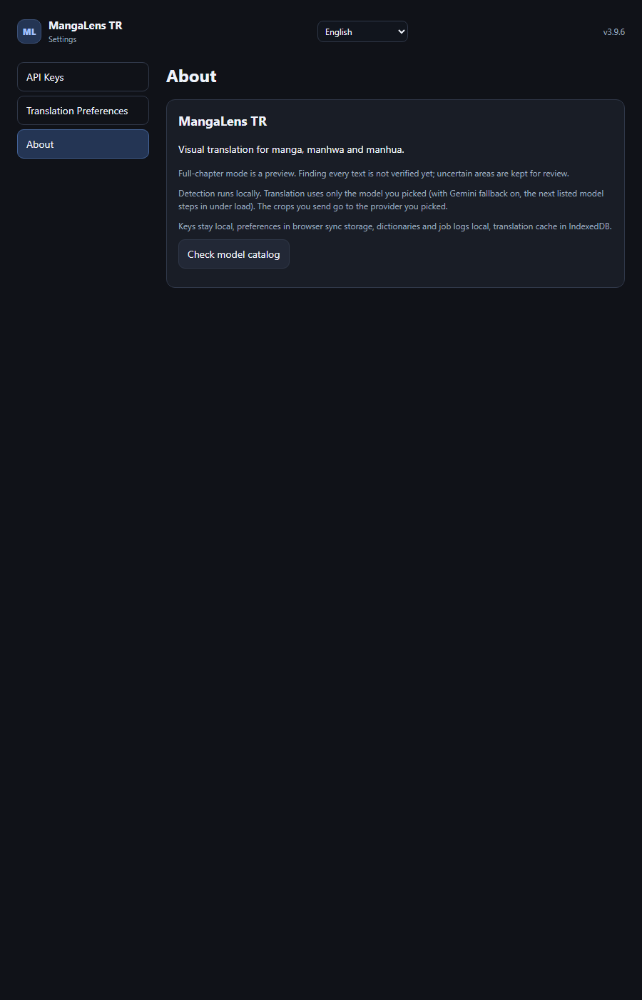

# MangaLens TR — manga sayfaları için Türkçe çeviri

> English: [README.md](./README.md)

**Mangayı Türkçe oku. Bir alan seç, ya da bütün bölümü çevir.**

MangaLens TR, manga, manhwa ve manhua sayfalarındaki İngilizce yazıları bulan, Gemini, OpenRouter veya Ollama üzerinden Türkçeye çeviren ve Türkçe metni balonun içine geri çizen bir Brave/Chromium Manifest V3 uzantısıdır.

Yazı tespiti yerelde çalışır. Yalnız seçtiğin kırpmalar seçtiğin sağlayıcıya gönderilir.

---

## İçindekiler

- [Ne yapar](#ne-yapar)
- [Ekranlar, tek tek](#ekranlar-tek-tek)
  - [1. Popup — Gemini](#1-popup--gemini)
  - [2. Popup — OpenRouter](#2-popup--openrouter)
  - [3. Ayarlar — API anahtarları](#3-ayarlar--api-anahtarları)
  - [4. Ayarlar — Çeviri tercihleri](#4-ayarlar--çeviri-tercihleri)
  - [5. Ayarlar — Hakkında](#5-ayarlar--hakkında)
- [Kurulum](#kurulum)
- [Çeviri nasıl akar](#çeviri-nasıl-akar)
- [Sağlayıcılar ve anahtarlar](#sağlayıcılar-ve-anahtarlar)
- [Verin nerede durur](#verin-nerede-durur)
- [Kaynaktan çalıştırma](#kaynaktan-çalıştırma)
- [Bilinen sınırlar](#bilinen-sınırlar)
- [Lisans](#lisans)

---

## Ne yapar

| Yetenek | Ayrıntı |
|---|---|
| **Alan seç** | herhangi bir yazının üzerine kutu çiz, Türkçesi yerine gelsin |
| **Oto çevir** | sayfanın yazı bloklarını bul, tek geçişte çevir |
| **Tam bölüm** | okuyucu sayfasını tara, her balonu çevir, sonucu güvenli alana yerleştir |
| **Üç sağlayıcı** | Gemini (doğrudan), OpenRouter veya yerel Ollama — sağlayıcı başına anahtar listesi |
| **Anahtar rotasyonu** | istekler kayıtlı anahtarları sırayla gezer; 429 yiyen veya kotası dolan anahtar dinlenir, sıradaki kullanılır |
| **Sağlayıcı yedekleme** | Gemini 429/503'te listedeki sonraki model otomatik denenir; diğer geçici hatalar yalnız sen açarsan zincirlenir |
| **Terim sözlüğü** | kendi adların ve terimlerin sayfalar arasında aynı Türkçe karşılıkla kalır |
| **Çeviri önbelleği** | aynı kırpma tekrar gönderilmez, saklanan sonuç kullanılır |
| **Yerel tespit** | yazı bölgeleri kendi makinede bulunur, tespit için yükleme yapılmaz |

---

## Ekranlar, tek tek

### 1. Popup — Gemini

Araç çubuğu popup'ı, 360 piksel geniş.

**Başlık** — logo ve ad, uzantıyı açıp kapatan anahtar, Ayarlar'ı açan çark.

**Sağlayıcı sekmeleri** — `Gemini`, `OpenRouter`, `Ollama`. Her sekme kendi modelini ve anahtar listesini tutar; sağlayıcı değiştirmek diğerlerini kaybettirmez.

**Çeviri modeli** — seçili sağlayıcının model listesi, etkin seçim işaretli. Altında anahtar özeti kaç anahtar kayıtlı olduğunu ve etkin olanın kullanılabilir olup olmadığını gösterir (`2 anahtar kayıtlı`).

**Eylemler**
- `Bölümün tamamını çevir` — tam bölüm yolu: sayfayı tara, her bloğu çevir, metni yerleştir.
- `Alan Seç` — sayfada kutu çiz, yalnız onu çevir.
- `Oto Çevir` — sayfanın yazı bloklarını otomatik bul ve çevir.

Düğmelerin altındaki not bilerek orada: *"Tam bölüm önizleme · Belirsiz alanlar kontrol gerektirir."* Tam bölüm bir önizleme özelliğidir — güvenle tanımlanamayan yazı, üzerine boyanmak yerine kontrol etmen için bırakılır.

**Kullanım sayaçları** — dakika, bugün, toplam. Gerçekten gönderilen istekleri sayar; önbellek isabetleri ve atlanan bloklar sayıyı şişirmez.

### 2. Popup — OpenRouter

Aynı popup, OpenRouter sekmesi etkin. Model listesi OpenRouter kataloğuna döner (`gpt-6-luna` varsayılan, alternatif olarak `gemma-4-26b` ve `muse-spark-1.3`) ve anahtar özeti o sağlayıcının kendi anahtarlarını yansıtır.

Her sağlayıcı bağımsızdır: Gemini anahtarı OpenRouter altında asla görünmez, tersi de geçmez.

Ollama aynı şekilde yerel bir uç noktaya karşı çalışır — bulut anahtarı yok, makineden istek çıkmaz.

### 3. Ayarlar — API anahtarları

Sol çubukta üç bölüm: **API Anahtarları**, **Çeviri Tercihleri**, **Hakkında**.

API anahtarları altında sağlayıcı başına bir sekme, her birinin kendi anahtar halkası:

- **Anahtar ekle** — bir etiket ve anahtarın kendisi.
- İlk eklenen anahtar otomatik etkin olur; geri kalanlardan hangisinin etkin olacağını sen seçersin.
- Anahtarlar yalnız bu tarayıcıda saklanır.

`Kontrol et` çeviri üretmeden bağlantıyı denetler. Altındaki not bunun ne anlama geldiği konusunda dürüst: başarılı kontrol, modelin hesaba açık olduğunu veya yaş onayının tamamlandığını kanıtlamaz.

### 4. Ayarlar — Çeviri tercihleri

**Okuma ve tarama**
- **İçerik türü** — `Otomatik / bilinmiyor`, `Manga`, `Manhwa`, `Manhua`. Balonların nasıl görünmesi gerektiğini ayarlar.
- **Yerel tarama** — `Hızlı yazı taraması (önerilen)`, `Alternatif balon taraması`, `Ayrıntılı balon taraması (yavaş)`. Hızlı varsayılandır; ayrıntılı, kapsama için hızdan feragat eder.
- **Çeviri yazı boyutu** — `Normal` veya `Büyük`.
- **Seri adı** — modelin karakter ve seri adlarını tutarlı tutmasına yardım eden isteğe bağlı bağlam.

**Dil ve terimler**
- **Çeviri yönergesi** — kendi üslup veya ton yönlendirmen.
- **Ad ve terim sözlüğü** — kaynak terim eşittir Türkçe karşılık; sayfalar arasında uygulanır.

**Sağlayıcı davranışı**
- *"Gemini 429/503'te her zaman sonraki modele otomatik geçer."* Bu iki kodda zincir her zaman ilerler. Açıkken diğer geçici hatalar (500/502/504) da zincirlenir; kapalıyken iş bu hatalarda durur, sessizce model değiştirmez.

`Kaydet` değişiklikleri yazar; `Değişiklik yok` bekleyen bir şey olmadığını gösterir.

### 5. Ayarlar — Hakkında

Sürüm, uzantının ne yaptığı ve tam bölümün bir önizleme olduğu, yazı kapsamının henüz insan etiketleriyle doğrulanmadığı notu.

Veri akışını da açıkça yazar:

- tespit yerelde çalışır,
- yalnız gönderdiğin kırpmalar seçtiğin sağlayıcıya gider,
- anahtarlar ve iş kayıtları yerelde, tercihler tarayıcı eşitleme alanında, çeviri önbelleği IndexedDB'de durur.

`Model kataloğunu kontrol et` model listesini sağlayıcıdan yeniler.

---

## Kurulum

Sürüm paketi: `MangaLensTR-3.9.5.zip`.

Uzantı kaynaktan paketsiz yüklenir:

1. `brave://extensions` (veya `chrome://extensions`) adresini aç.
2. **Geliştirici modu**nu aç.
3. `Paketsiz yükle` ve `manifest.json` içeren klasörü seç.
4. Popup'ı aç, Ayarlar'a git ve en az bir API anahtarı ekle.

## Çeviri nasıl akar

1. **Tespit** — sayfanın yazı bölgeleri yerelde bulunur.
2. **Kırp** — her bölge görüntü olarak kesilir.
3. **Gönder** — kırpmalar seçili sağlayıcıya, modelle ve senin yönergenle gider.
4. **Doğrula** — yanıt kontrol edilir; bir bölgeye bağlanamayan cevap boyanmaz.
5. **Yerleştir** — Türkçe metin balonun güvenli alanına, seçtiğin yazı boyutuyla çizilir.
6. **Önbellekle** — sonuç saklanır, aynı kırpma ikinci kez gönderilmez.

Paralellik uyarlanır: Gemini anahtar başına bir şerit açar (en fazla 4), anahtar başına 2,5 sn aralık ve dakikada 12 istek korunur; OpenRouter 4 → 6 → 8 eşzamanlı isteğe çıkar. Tüm anahtarlar tükendiğinde iş başarısız olmak yerine pencere bitimini bekler ve otomatik devam eder.

## Sağlayıcılar ve anahtarlar

| Sağlayıcı | Gereken | Not |
|---|---|---|
| **Gemini** | Google AI Studio anahtarı | doğrudan yol, arada aracı yok |
| **OpenRouter** | OpenRouter anahtarı | tek anahtar birçok model ailesine ulaşır |
| **Ollama** | yerel Ollama sunucusu | makineden hiçbir şey çıkmaz |

Sağlayıcı başına anahtarlar liste olarak saklanır. İstekler listeyi sırayla gezer, her anahtar eşzamanlılık sınırına kadar hizmet eder, sonra başa dönülür. 429 yiyen veya kotası dolan anahtar bir süre dinlendirilir ve atlanır.

## Verin nerede durur

| Ne | Nerede |
|---|---|
| API anahtarları | yalnız bu tarayıcıda (uzantı yerel depolaması) |
| Tercihler | tarayıcı eşitleme alanı |
| Terim sözlükleri, iş kayıtları | yerel |
| Çeviri önbelleği | IndexedDB |

Analitik yok, hesap yok, telemetri sunucusu yok. Tek dış trafik seçtiğin sağlayıcıya gönderdiğin kırpmadır — Ollama ile makineden hiçbir şey çıkmaz.

## Kaynaktan çalıştırma

Derleme adımı yok: uzantı düz HTML/CSS/JS olarak paketsiz yüklenir. Üzerinde çalışmak için:

1. Klasörü yukarıdaki gibi paketsiz yükle.
2. `popup/`, `options/`, `content/` (veya `page/`) altındaki dosyaları düzenle.
3. Uzantı kartındaki yenile düğmesine bas ve manga sayfasını yenile.

## Bilinen sınırlar

- **Tam bölüm bir önizlemedir.** Bütün yazı bloklarını bulmak ve ~%98 kalite hedefi henüz insan etiketleriyle doğrulanmadı; belirsiz bölgeler kontrol için bırakılır.
- Tespit yerel ve hızlıdır, ama süslü yazıları, hareketli çizim üzerindeki metni veya dikey yazıyı kaçırabilir.
- Başarılı `Kontrol et` anahtarın kabul edildiğini kanıtlar — modelin hesaba açık olduğunu veya yaş onayının yapıldığını değil.
- Çeviri kalitesi modele bağlıdır; uzantı modelin Türkçesini ayrıca düzenlemez.
- Ücretsiz anahtarlar hız sınırına takılır; rotasyon çalışmaya devam eder ama büyük bir bölüm daha uzun sürer.

## Lisans

MIT — bkz. [LICENSE](./LICENSE).
